  

  <picture>
    <source media="(prefers-color-scheme: dark)" srcset="https://raw.githubusercontent.com/przemekbladowski/przemekbladowski/output/contribution-grid-dark.svg" />
    
  </picture>

  
  

  
  

---

  <h2>🛠️ Tech Stack</h2>

| **Front-end** | **Back-end & Data** | **Tools & Design** |
| :---: | :---: | :---: |
|  |  |  |

---

  <h2>🚀 Featured Projects</h2>

<table>
  <tr>
    <td width="33%" valign="top">
      <h3>📚 EduDash</h3>
      School management system for private tutors and administrators — lesson scheduling, room allocation and automated payroll reports. Mobile-first UX.
        
      
      
      
      
      
        
      <a href="https://github.com/przemekbladowski/EduDash">🔗 Repository</a> · <a href="https://edu-dash-nine.vercel.app">🌐 Demo</a>
    </td>
    <td width="33%" valign="top">
      <h3>👁️ OTO OKO</h3>
      Management system for an optician's salon (engineering thesis, team project) — appointment booking, eye exams, in-store sales with QR payments and stock control.
        
      
      
      
      
      
        
      🔒 Private repository
    </td>
    <td width="33%" valign="top">
      <h3>🛠️ OTO OKO Admin</h3>
      Admin panel for the OTO OKO system.
        
      
      
      
        
      🔒 Private repository
    </td>
  </tr>
  <tr>
    <td width="33%" valign="top">
      <h3>👥 ScienceHub</h3>
      Social portal for scientists — profiles, posts, comments and likes. Next.js frontend talking to a FastAPI + SQLite backend.
        
      
      
      
      
        
      <a href="https://github.com/przemekbladowski/ProjektReact">🔗 Repository</a> · <a href="https://my-app-ten-rho-10.vercel.app">🌐 Demo</a>
    </td>
    <td width="33%" valign="top"></td>
    <td width="33%" valign="top"></td>
  </tr>
</table>
